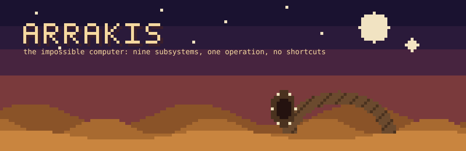
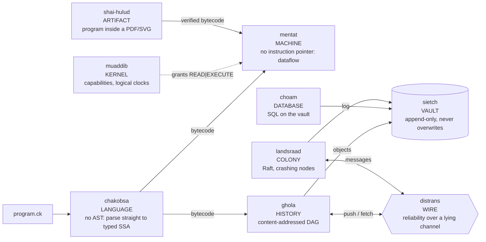

# ARRAKIS: the impossible computer



**Nine small systems, each built after removing one thing ordinary computers can't live without:** a CPU with no instruction pointer, storage that never overwrites a byte, a compiler with no syntax tree, a kernel with no paths and no clock, a network that lies. Then all of them carry **one real operation end to end**, and every disaster along the way can be replayed exactly from a seed.

[Install](INSTALL.md) · [Demos](docs/DEMOS.md) · [How it works](docs/GUIDE.md) · [Roadmap](ROADMAP.md) · [Contributing](CONTRIBUTING.md)

```text
$ arrakis chaos --seed 7

REPLICATE  it crosses a hostile network and a crashing cluster
   6. [distrans ] pushed the repository to the server: 170 ticks, 4 calls, 67 datagrams sent, 6 dropped, 6 duplicated, 1 corrupted
   7. [landsraad] 3 nodes (storage on sietch) agreed on release/latest = ea8403fa9104 after 2501 ticks, 11 crashes, 11 restarts, 3 leader terms, under partitions
...
  VERIFIED   main() = 775 on the publisher AND on the consumer
  network    134 datagrams sent: 22 dropped, 9 duplicated, 1 corrupted
             7 RPCs, each executed exactly once on the server
  consensus  11 node crashes, 6 messages cut by partitions, agreed after 2501 ticks
  checks     every object hash, manifest = SQL registry = publisher hash,
             WRITE denied, widening refused, capability dead after revoke
  time       0.10 s of real time; every network and cluster clock is simulated
  replay     arrakis chaos --seed 7   reproduces this run exactly
```

A program is compiled (with no AST), committed to a content-addressed history, stored in an append-only vault, indexed in SQL, replicated by a three-node Raft cluster that is crashed and partitioned while it works, pushed and fetched over a network that drops, duplicates, reorders and corrupts packets, verified, and run under least privilege on the other side. It gives the same answer as on the publisher's machine, every hop is checked, and nothing runs if any check fails. Everything is written from scratch in Rust: no SQL engine, Raft library, TCP stack, VM, compiler framework or version-control library was imported (ghola even implements SHA-256 itself and checks it against a reference crate). It is an experiment and a teaching codebase, not production software ([limits](#limits-and-non-goals)).

## Quick start

**Prebuilt binary** (Windows x64, Linux x64/ARM64, macOS Apple Silicon): download from [Releases](https://github.com/n-3-0-l-d-3-v/arrakis/releases), check the SHA-256, unpack, and run `./arrakis demo` from the folder. Details and verification: [INSTALL.md](INSTALL.md).

**From source** (you need [Rust](https://rustup.rs) and git; about five minutes):

```bash
git clone https://github.com/n-3-0-l-d-3-v/arrakis && cd arrakis
./arrakis.sh                        # Windows PowerShell: .\arrakis.ps1
```

That builds the stack and runs every headline demo. Or use Cargo directly from the root: the root `Cargo.toml` is a workspace whose default binary is `arrakis`, and `Cargo.lock` is committed, so `--locked` builds exactly the tested dependency set:

```bash
cargo run --release --locked -- demo        # or: chaos, sabotage, examples, run examples/fib.ck, --help
```

If PowerShell says scripts are disabled, run `powershell -ExecutionPolicy Bypass -File .\arrakis.ps1` (affects that process only). **No Rust?** `docker build -t arrakis . && docker run --rm arrakis`.

## Four demos

| Demo | Command | What it shows |
|---|---|---|
| **A. The whole system** | `arrakis demo` | one program through all eight layers on a clean network, twelve numbered steps, each naming the layer that did it |
| **B. The hostile network** | `arrakis chaos --seed 42` | the same under 15% loss plus duplication, reordering, corruption and truncation, with the cluster crashed and partitioned; same answer; the seed replays it byte for byte |
| **C. Sabotage** | `arrakis sabotage` | one bit flipped on the server, then a lying SQL registry: each is caught and nothing executes. Also `pack` / `tamper` / `open`: change one character of a program hidden in a PDF and it is refused |
| **D. The individual systems** | `./arrakis.sh tour` | each subsystem's own tool: machine, kernel, wire, colony, vault, database, history; plus `arrakis run`, `arrakis artifact` |

[docs/DEMOS.md](docs/DEMOS.md) explains each one: the assumption removed, the mechanism that replaces it, what to look at, and what it does and does not prove. `--html FILE` keeps a run as one self-contained page; `--json` gives one object for scripts ([docs/WORKFLOWS.md](docs/WORKFLOWS.md)). In a terminal the output is coloured ([the look](docs/design/DIRECTIONS.md)); redirected it is plain ASCII, and `--color never|always|auto` and `NO_COLOR` override that.

## The headline: one operation through every layer

*Publish a program, then run it safely somewhere else.* Each step checks the one before it; a failure anywhere stops the operation instead of being papered over.

| # | Layer | What happens | What is checked |
|---|---|---|---|
| 1 | chakobsa | source compiled to mentat bytecode, typed SSA built during parsing, no AST | type errors and a missing `main` stop here |
| 2 | mentat | the publisher runs it: the reference answer | |
| 3 | ghola | source, bytecode and manifest committed as content-addressed objects | the commit id is a pure function of the content |
| 4 | sietch | the repository lives in an append-only checksummed log | no byte is ever overwritten |
| 5 | choam | the release is indexed in a SQL table and read back | the row equals what was inserted |
| 6 | distrans | the repository is pushed over a hostile network | the server holds exactly the commit; every RPC ran exactly once |
| 7 | landsraad | a 3-node Raft cluster on sietch, crashed and partitioned, agrees on the release | all three replicated state machines hold the same head |
| 8 | distrans + ghola | the consumer fetches over a second hostile network | every object re-hashed on arrival |
| 9 | ghola + choam | the artifact hash must equal the manifest **and** the SQL registry **and** the publisher's | any mismatch aborts before anything runs |
| 10 | muaddib | the runner gets READ and EXECUTE only | WRITE denied; widening a capability by derivation refused |
| 11 | mentat | the consumer runs the fetched bytecode | the answer must equal the publisher's |
| 12 | muaddib | the region is revoked | the runner's capability stops working |

The proof that this is not decorative: [`integration/tests`](integration/tests) runs it across six seeds at 20% loss, sabotages the server copy and the registry independently (each is caught, and removing the registry check makes the sabotage test fail), rejects bad programs at layer 1, and differentially checks 48 random programs against Rust's own arithmetic, half of them across the hostile stack. Details: [docs/INTEGRATION.md](docs/INTEGRATION.md).

## Architecture



Every arrow is a real Cargo dependency or a real call in the [integration pipeline](integration/src/pipeline.rs).

## The subsystems

| Subsystem | Codename | Assumption removed | What that forced us to build | Try it |
|---|---|---|---|---|
| [mentat](mentat/) | THE MACHINE | an instruction pointer | a dependency-scheduled dataflow VM, 8-byte ISA, assembler, deterministic tamper-detecting replay | `./arrakis.sh machine` |
| [sietch](sietch/) | THE VAULT | overwriting bytes | append-only log, MVCC, B+tree pages, compaction with crash-safe commit marker, group commit, snapshot isolation | `./arrakis.sh vault` |
| [chakobsa](chakobsa/) | THE LANGUAGE | a syntax tree | a parser that emits typed SSA directly (incremental, no dominance frontiers), codegen and register allocation for mentat | `arrakis run examples/fib.ck` |
| [muaddib](muaddib/) | THE KERNEL | paths and a wall clock | unforgeable attenuable capabilities, ownership-moving IPC, Lamport + vector clocks | `./arrakis.sh kernel` |
| [distrans](distrans/) | THE WIRE | a reliable network | framing + CRC-32C, selective-repeat transport, flow and AIMD congestion control, exactly-once RPC | `./arrakis.sh wire` |
| [choam](choam/) | THE DATABASE | a separate storage engine | a SQL parser, executor and transactions running only on sietch; `choamc` shell | `./arrakis.sh database` |
| [landsraad](landsraad/) | THE COLONY | one machine and a global clock | Raft over distrans frames with state on sietch, a cluster simulator with partitions and crashes, a per-tick invariant checker | `./arrakis.sh colony` |
| [ghola](ghola/) | THE HISTORY | mutable files | from-scratch SHA-256, content-addressed objects, commit DAG, Myers diff, 3-way merge, push/pull over distrans | `./arrakis.sh history` |
| [shai-hulud](shai-hulud/) | THE ARTIFACT | "documents are just data" | a program inside a PDF/SVG, run only by a strict structural loader in a sandbox | `./arrakis.sh artifact` |
| [integration](integration/) | Phase 10 | components working alone | one operation through every layer, plus the `arrakis` CLI | `arrakis chaos` |

Each subsystem is also its own repository (github.com/n-3-0-l-d-3-v/&lt;name&gt;), mirrored here commit for commit; parity is checked by git tree hash ([CONTRIBUTING.md](CONTRIBUTING.md)).

### The program that hides in a PDF

```bash
arrakis pack examples/fib.ck -o out/fib.pdf       # compile, then embed in an ordinary one-page PDF
arrakis inspect out/fib.pdf                       # verify structure + SHA-256, show the program; nothing runs
arrakis open out/fib.pdf                          # verify, then run in mentat's sandbox  ->  returned 6765
arrakis tamper out/fib.pdf -o out/bad.pdf         # change ONE character of the hidden program
arrakis open out/bad.pdf                          # error: payload integrity check failed -- refused, nothing was run
```

Open `out/fib.pdf` in a PDF viewer: it is a normal one-page document, an archive card that lists what it carries ([ADR-002](shai-hulud/docs/design/decisions/ADR-002-archive-page-and-hex-text.md)). The program is a standard PDF attachment (in an SVG, base64 in `<metadata>`) and **no viewer executes it**. Only this loader, invoked on purpose, extracts it. It walks the file's own xref table, requires exactly one payload, caps its size, verifies SHA-256, validates the program, and runs it in a VM with no host I/O, a memory cap and a step budget. PDFs re-saved by other tools still load if they stay uncompressed and single-revision; anything else is refused by name ([ADR-003](shai-hulud/docs/design/decisions/ADR-003-structural-pdf-reading.md)). A property test proves any single-byte corruption yields an error or the identical program, never a different one. The hash proves **integrity, not authorship**: there is no signature yet, and the output says so.

## Things to explore

```bash
arrakis chaos --seed 42                     # a different disaster, still the same answer
arrakis chaos --loss 0.3                    # a nastier network
arrakis chaos --seed 42 --html out/chaos.html   # the run as one self-contained page
arrakis demo --program examples/bank.ck --chaos # your own program through the hostile stack
arrakis run examples/primes.ck              # compile + run one program on the dataflow machine
arrakis --json open out/fib.pdf             # one JSON object, for scripts
./arrakis.sh test all                       # every test suite in every workspace
```

(`arrakis …` is the prebuilt binary or `cargo run --release --locked -- …`; `./arrakis.sh …` and `.\arrakis.ps1 …` pass any command through.)

What you can learn here:

- **How a CPU, a database, TCP, Raft and git actually work**, from code small enough to read in an afternoon each. [docs/GUIDE.md](docs/GUIDE.md) explains every component twice: plainly, then with the computer science.
- **Which parts of each are forced and which are convention.** Removing one assumption shows what really depends on it; each component's ADRs say what was forced ([docs/CONSTRAINT_MATRIX.md](docs/CONSTRAINT_MATRIX.md)).
- **How to test systems that fail.** Property tests over invariants, differential tests against independent reference implementations, mutation checks (break the code on purpose and confirm a test notices), and seeded chaos you can replay exactly.
- **How to write engineering down honestly.** 50+ ADRs, each recording what was decided, what broke, and what was measured, including the results that look bad.

## Evidence: tests and measurements

About 830 tests across the ten workspaces (unit, property, differential, replay and regression tests), all passing with `fmt` and `clippy -D warnings` clean; CI runs the integration suite and the quickstart on Linux, Windows and macOS. Nothing below is tuned to look good. The numbers come from the ADRs, with why they are what they are; they were measured on one development machine and are useful as ratios, not as absolute speeds.

| Measurement | Context |
|---|---|
| **sietch** bounded range scans stay at ~20–24 µs from 1,000 to 50,000 entries; a full scan grows from ~85 µs to ~5.4 ms | leaf-sibling pointers, added after measuring the full-traversal design |
| **sietch** group commit: ~7.5× faster at 10 writes per fsync, ~57× at 100, ~260× at 1,000 | one fsync per batch, with the same crash-recovery contract |
| **sietch** an early indexed store reopened ~12× *slower* than the plain log | an architectural defect, reported, then fixed by the heap-page store (ADR-004/005) |
| **muaddib** least privilege costs 17.4× end to end at 64-byte messages, 1.35× at 4 KiB | per-message capability and clock bookkeeping; it amortizes with payload. One check is ~9 ns |
| **chakobsa** compiled code runs 10–100× *slower* on mentat than the project's own reference interpreter; compile time is quadratic in single-block size | no optimization passes yet, a dataflow-scheduled VM, and an interference-graph register allocator (root-caused, ADR-006) |
| **distrans** go-back-N is 7.7× faster than stop-and-wait on a perfect channel, and *worse* than stop-and-wait once anything is reordered | the measured reason this transport uses selective repeat |
| **distrans** is the *worst* of the three designs at 20% loss | AIMD's multiplicative decrease collapses the window faster than slow start recovers; left visible, not tuned away |
| **ghola** 100 commits of a 50-file tree take 3.7% of the space of full copies; 10% loss costs 129× the ticks for only 1.4× the datagrams | content addressing dedups; loss costs latency, not bandwidth |
| **landsraad** the invariant checker caught 4 of 5 deliberately injected Raft bugs | the 5th (Raft paper Figure 8) is caught only by a scripted test, not by random search |
| **integration** the full hostile pipeline runs in about 0.1 s of real time | all network and cluster time is simulated, so runs are fast and exactly reproducible |

Found and fixed while preparing releases, each with a regression test that fails without the fix: `and`/`or` in a `while` condition did not compile ([chakobsa ADR-007](chakobsa/docs/design/decisions/ADR-007-short-circuit-while-conditions.md)); constants wider than 32 bits did not compile ([chakobsa ADR-008](chakobsa/docs/design/decisions/ADR-008-64-bit-constants.md)); and the PDF loader read the *first* revision of an incrementally updated file, so it could run a program the document no longer carried ([shai-hulud ADR-003](shai-hulud/docs/design/decisions/ADR-003-structural-pdf-reading.md)).

## Limits and non-goals

- **Not production infrastructure.** The networks and the Raft cluster are simulations inside one process, in virtual time; there are no real sockets. muaddib's kernel is a simulation too, and the sandbox is not an operating-system boundary ([SECURITY.md](SECURITY.md)).
- **Not a general-purpose language.** chakobsa has `i64`, `bool`, functions, `if`, `while` and recursion. No arrays, strings or I/O.
- **Not a security product.** shai-hulud's hash proves integrity, not authorship (anyone can re-pack a file), and its PDF reader handles a stated subset of PDF.
- **Not fast.** See the table above. Correctness and clarity came first, and the numbers are published.
- **Not exhaustively tested for every failure.** Random schedule search misses one known Raft bug; chaos runs are samples, replayable but not proofs.

What comes next, and what is research: [ROADMAP.md](ROADMAP.md). The full assessment of each limitation: [docs/RELEASE_READINESS.md](docs/RELEASE_READINESS.md).

## Documentation

| If you want to… | Read |
|---|---|
| install it on any platform, verify a download | [INSTALL.md](INSTALL.md) |
| see each demo's real output, explained | [docs/DEMOS.md](docs/DEMOS.md) |
| use it: write, run, send, script (`--json`), replay a run | [docs/WORKFLOWS.md](docs/WORKFLOWS.md) |
| understand the whole thing | [docs/GUIDE.md](docs/GUIDE.md), the learning guide |
| follow the operation layer by layer | [docs/INTEGRATION.md](docs/INTEGRATION.md) and [integration/src/pipeline.rs](integration/src/pipeline.rs) |
| see how each constraint forced each design | [docs/CONSTRAINT_MATRIX.md](docs/CONSTRAINT_MATRIX.md) |
| read the decisions and failures | `<subsystem>/docs/design/decisions/ADR-*.md` |
| see how it was built, ticket by ticket | [docs/HISTORY.md](docs/HISTORY.md), [docs/PHASES.md](docs/PHASES.md), `<subsystem>/tickets/` |
| check what "done" means here | [docs/PUBLIC_DOD.md](docs/PUBLIC_DOD.md) |
| know what changed | [CHANGELOG.md](CHANGELOG.md) |

## Community

Questions and ideas: [Discussions](https://github.com/n-3-0-l-d-3-v/arrakis/discussions). Bugs: [issues](https://github.com/n-3-0-l-d-3-v/arrakis/issues/new/choose), with the command and the seed. Contributions are welcome, small and focused is best: [CONTRIBUTING.md](CONTRIBUTING.md). Please follow the [Code of Conduct](CODE_OF_CONDUCT.md); report security problems privately ([SECURITY.md](SECURITY.md)); help and support: [SUPPORT.md](SUPPORT.md).

**Why "Arrakis"?** Dune's desert planet, where every basic assumption (water, shelter, movement itself) has to be re-engineered just to survive. That is this project's premise. Each subsystem's README explains its own name.

MIT licensed. See [LICENSE](LICENSE).
