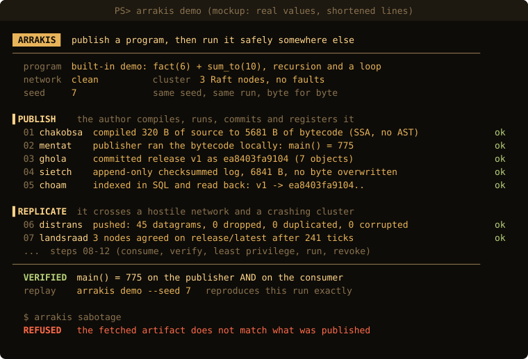
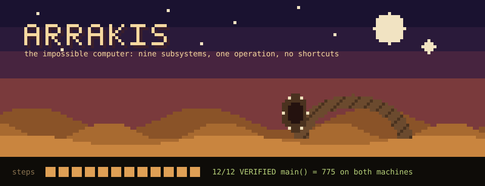
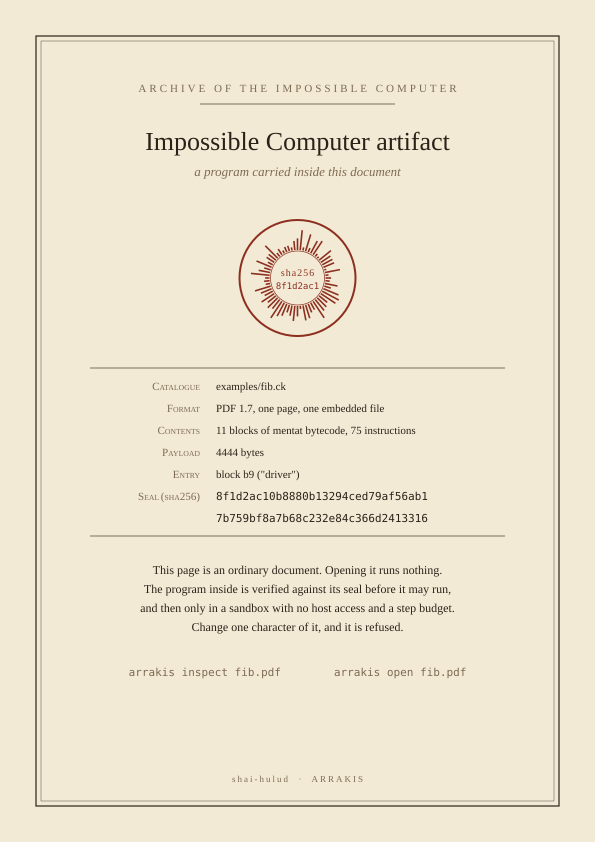

# Visual directions (Phase 4 proposal, static mockups)

Three restrained directions for ARRAKIS's look. These are mockups, not shipped
output: every number in them comes from a real run on 2026-11-26
(`arrakis demo`, `arrakis sabotage`, `arrakis pack examples/fib.ck`), but
lines are shortened to fit. Nothing here is implemented yet.

## A. Retro Unix terminal: for every line the CLI prints

- An amber-phosphor palette (amber text, dim amber-grey for labels, pale green
  for `ok`/`VERIFIED`, red only for `REFUSED`/errors). One reverse-video title
  block. `─` rules replace `----`. A `▌` bar marks each phase. Steps are
  numbered `01`–`12` with a right-aligned `ok`.
- Same information as today, nothing invented. Colour carries meaning only:
  success, refusal, labels.
- Constraints for Phase 5:
  - Colour only when stdout is a terminal. Honour `NO_COLOR`, and add
    `--color never|auto|always`.
  - Keep an ASCII fallback for `─`/`▌`. Windows PowerShell 5.1 decodes
    redirected output with the OEM code page, so UTF-8 box characters turn
    into garbage in captured logs.
  - Never put colour codes into `--quiet` program output.

## B. Pixel Arrakis: for the README banner and docs headers only

- A 6-px pixel grid. The sky is banded (no gradients), with dunes, two moons
  and a breaching sandworm. "ARRAKIS" uses a hand-set 5×7 pixel font. A strip
  of 12 tiles shows the 12 demo steps.
- The art is original. Nothing is copied from any Dune film, game or book
  artwork.
- Terminal output stays in direction A, not pixel art: pixel blocks in a
  console are noise and break in narrow or legacy terminals.

## C. Imperial archive: for shai-hulud's PDF/SVG containers

- The page that a viewer shows when someone opens `fib.pdf`. Parchment
  background, double rule border, serif type, a catalogue table (source,
  format, block count, instruction count, payload size, entry block, full
  sha256), and a plain-language note: opening the page runs nothing, and the
  program is verified before it may run.
- The "seal" is a fingerprint of the real payload hash: 64 ticks, one per hex
  digit. It is deliberately not a "verified" stamp. A document cannot vouch
  for itself; only `arrakis open` verifies.
- Phase 6 constraints:
  - Standard PDF fonts only (Times/Helvetica/Courier), so nothing is embedded
    and the file stays small.
  - Every printed value comes from the payload at pack time.
  - The loader must keep finding exactly one embedded payload. Today it
    searches the file text (audit problem 3), so the page text must not
    contain `/Type /EmbeddedFile`. A regression test belongs with the change.

## Status

Approved: A + B overall, C for shai-hulud.

**Applied in Phase 5:**
- **A, in the `arrakis` CLI** (`integration/src/style.rs`):
  - The demo/chaos report, `sabotage`, `examples` and `error:` lines.
  - `--color auto|always|never` and `NO_COLOR` control it.
  - Redirected output is unchanged plain ASCII, and a test checks this.
  - Unlike the mockup, demo steps keep their `[layer]` tags and have no
    right-aligned `ok`. The real step lines are too long to align, and a step
    that fails stops the run anyway.
- **A, in the front-door scripts:** their headings and commands use the same
  palette.
- **B, in the README:** `banner.svg`, without the status strip, because a
  static image must not look like a live result.

**Not yet:**
- C (Phase 6).
- The subsystem CLIs (`imc`, `vaultc` ...), which keep their own plain output.

## Recommendation

Use **A + B as the overall identity** and **C for shai-hulud only**. A is
where people actually spend their time (the CLI and the quickstart). B gives
the README a face without touching terminal output. C suits the one place
where a formal, printed document is the point.

The mockups are generated by `src/mockups.py` (`python docs/design/src/mockups.py docs/design`), so they can be regenerated if
values change. Fonts fall back to system monospace/serif. GitHub renders
these SVGs as images, so no web fonts load.
